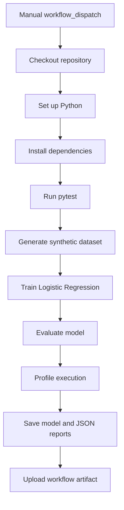

# Architecture — Phase 1

## Current execution flow

## Target architecture

The eventual platform has three independently callable workflows:

- **CI:** validates code, data contracts, feature transformations, model behavior and component integration.
- **CT:** ingests versioned data, validates it, trains candidate models, evaluates drift and quality, and decides whether a candidate should be promoted.
- **CD:** packages validated models, deploys to a test/staging simulation, runs service-level checks, and promotes or rolls back versions.

A top-level orchestrator will coordinate these workflows. Cross-workflow triggers will use explicit GitHub workflow dispatch or reusable workflow mechanisms; a file written on one ephemeral runner does not itself trigger another workflow.

## Phase 1 boundaries

This phase does not yet implement a production model registry, persistent deployment, real-time monitoring, or drift-triggered retraining. It creates the baseline training workload and records the metadata needed by later phases.
