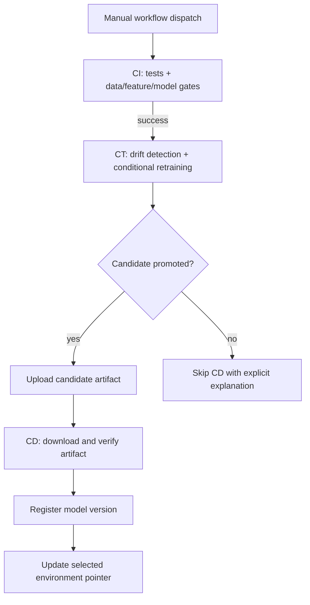

# Phase 5 — Integrated CI → CT → CD Orchestration

## Objective

Phase 5 composes the previously validated CI, CT and CD command contracts into one manually dispatched GitHub Actions workflow. The workflow uses three dependent jobs and GitHub Actions artifacts as explicit handoff boundaries.

## Execution graph



## Job contracts

| Job | Input | Output |
|---|---|---|
| CI | Repository source, CI config, optional failure injection | CI report artifact |
| CT | Successful CI job, selected scenario | CT diagnostics; candidate artifact only when promoted |
| CD | Promoted candidate artifact from CT job | Versioned registry and environment pointer |

All three jobs run on GitHub-hosted Ubuntu runners. The workflow is manually triggered only; it does not run on pushes.

## Inputs

- `scenario`: `stable`, `covariate_shift`, `concept_drift`, or `corrupted_data`. Defaults to `covariate_shift` to exercise the candidate path.
- `target_environment`: `dev`, `staging`, or `prod`. These are simulated registry environments; this workflow does not deploy to external infrastructure.
- `failure_mode`: optional Phase 2 CI failure injection. Defaults to `none`.

## Artifact naming

- `phase5-ci-RUN_ID-ATTEMPT`: CI evidence.
- `phase5-ct-RUN_ID-ATTEMPT`: CT report and diagnostics.
- `phase5-candidate-RUN_ID-ATTEMPT`: model, CT report and candidate manifest, only when promoted.
- `phase5-registry-RUN_ID-ATTEMPT`: versioned registry after successful CD.

Artifacts are scoped to the Phase 5 workflow run. The CD job downloads the candidate from the CT job in the same workflow run, avoiding a second GitHub API discovery step and avoiding manual run IDs.

## Conditional behavior

- CI failure blocks CT and CD.
- CT failure blocks CD.
- A stable CT execution may pass without promoting a candidate. In that case, CD is intentionally skipped and the `no-candidate` job records why.
- `covariate_shift` and `concept_drift` are intended to exercise retraining and candidate promotion.
- `corrupted_data` is a negative test and should fail CT after preserving diagnostics.

## Security and reproducibility

- `GITHUB_TOKEN` is not required for cross-job artifact download because all artifacts belong to the same workflow run.
- The candidate manifest binds the model checksum to the Phase 5 run ID, attempt, commit and branch.
- CD verifies the expected source run ID and model SHA-256 before registration.
- No secrets, external dataset downloads, GPU or cloud services are required.

## Local simulation

Run the three stages sequentially:

```bash
python -m pytest -q
python -m mlops_lab.cli run-ci --config configs/ci.yaml --output-dir artifacts/ci-runs
python -m mlops_lab.cli run-ct --config configs/ct.yaml --output-dir artifacts/ct-runs --scenario covariate_shift
```

Then point `run-cd` to the generated CT run directory containing the candidate model, report and manifest. Supply the same `GITHUB_RUN_ID` value used when generating the manifest if testing the provenance guard.

## Limitations

This is an orchestration simulation. `dev`, `staging` and `prod` are filesystem registry pointers, not real cloud deployments. Phase 5 currently invokes the same tested CLI contracts in dependent jobs rather than calling the standalone Phase 2/3/4 workflows as reusable workflows. This provides deterministic artifact handoffs inside one run. Standalone workflows remain available for isolated testing.
